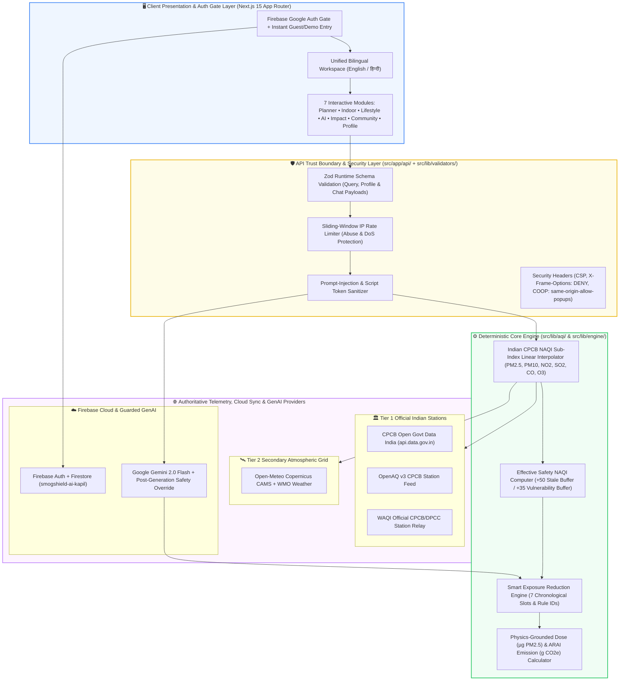
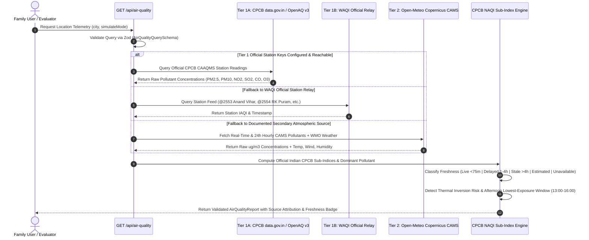
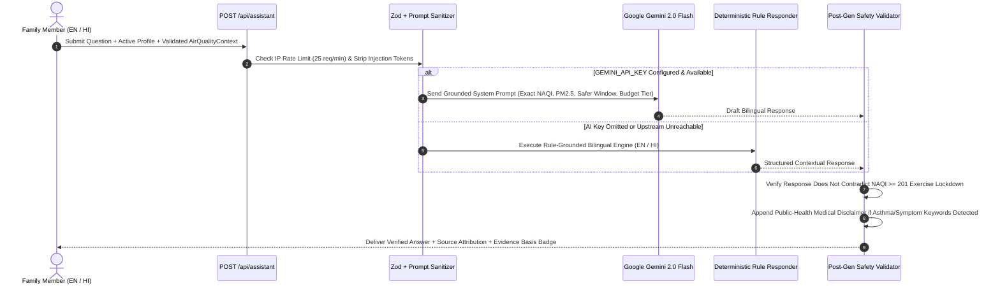

<div align="center">

# 🌫️ PROMPTWARS × CATALYST 2026
## `SmogShield-AI` (`स्मॉगशील्ड एआई`)

### **Challenge Vertical:** Climate Tech, Environmental Public-Health Intelligence & Sustainable Household Decision Support
### **Problem Statement:** GenAI Assistant Helping Families and Communities Navigate Severe Winter Smog and Urban Air Pollution
### **Core Principle:** *From Air-Quality Awareness to Actionable Family Protection*
### **Author:** `Kapil Jangid`

---

[](https://opensource.org/licenses/MIT)
[](https://nodejs.org/)
[](https://nextjs.org/)
[](https://www.typescriptlang.org/)
[](https://react.dev/)
[](https://tailwindcss.com/)
[](https://firebase.google.com/)
[](https://ai.google.dev/)
[](https://cpcb.nic.in/National-Air-Quality-Index/)
[](https://github.com/DietrichGebert/ponytail)
[](#-automated-testing--verification-suite)

<p align="center">
  <b>SmogShield AI — Deterministic Environmental Safety &amp; Bilingual Family Protection Platform</b><br>
  <i>"Raw AQI numbers create anxiety. Contextual, deterministic safety rules combined with grounded AI create protection."</i><br>
  <i>"A conventional AQI app shows a number. SmogShield AI tells your family what to do differently at 06:30 AM, 01:30 PM, and 10:00 PM."</i>
</p>

</div>

---

## 📑 Table of Contents

- [Executive Overview](#-executive-overview)
- [The Winter Smog Dilemma vs. How SmogShield AI Solves It](#-the-winter-smog-dilemma-vs-how-smogshield-ai-solves-it)
- [System Architecture &amp; The 4-Layer Intelligence Triad](#-system-architecture--the-4-layer-intelligence-triad)
- [Decision Cycles &amp; Data Flow Diagrams](#-decision-cycles--data-flow-diagrams)
  - [1. Multi-Tier Air Quality Acquisition &amp; CPCB NAQI Normalization Flow](#1-multi-tier-air-quality-acquisition--cpcb-naqi-normalization-flow)
  - [2. The 9-Step Deterministic Household Recommendation Pipeline](#2-the-9-step-deterministic-household-recommendation-pipeline)
  - [3. Safety-Guarded Bilingual GenAI Assistant Flow](#3-safety-guarded-bilingual-genai-assistant-flow)
- [Technical Stack &amp; Component Breakdown](#-technical-stack--component-breakdown)
- [Scientific Formulations, CPCB Breakpoints &amp; Safety Guardrails](#-scientific-formulations-cpcb-breakpoints--safety-guardrails)
  - [Separating Deterministic Safety Rules from AI Explanations](#separating-deterministic-safety-rules-from-ai-explanations)
  - [Mathematical &amp; Physical Formulations](#mathematical--physical-formulations)
  - [Distinguishing Exposure Reduction vs. Indoor Air vs. Emissions](#distinguishing-exposure-reduction-vs-indoor-air-vs-emissions)
- [Complete Module Matrix (Modules A through I)](#-complete-module-matrix-modules-a-through-i)
- [Data Sources, Freshness Classification &amp; Limitations](#-data-sources-freshness-classification--limitations)
- [Feasibility, Resource Equity &amp; Mitigation Strategies](#-feasibility-resource-equity--mitigation-strategies)
- [Competitive Benchmarking Matrix](#-competitive-benchmarking-matrix)
- [Research Citations &amp; Public-Health References](#-research-citations--public-health-references)
- [Repository Structure](#-repository-structure)
- [Local Setup, Environment Variables &amp; Quick Start](#-local-setup-environment-variables--quick-start)
- [Automated Testing &amp; Verification Suite](#-automated-testing--verification-suite)

---

## 💡 Executive Overview

Every winter across Northern and Central India—and increasingly across major urban corridors nationwide—radiative surface cooling, calm boundary-layer winds (`< 7 km/h`), vehicular cold-start emissions, biomass heating, and atmospheric stagnation trap hazardous concentrations of $\text{PM}_{2.5}$, $\text{PM}_{10}$, $\text{NO}_2$, and $\text{CO}$ within 50 meters of ground level.

Families and communities face a severe daily decision gap:
1. **Standard AQI Dashboards Stop at Raw Numbers:** Most weather apps display US-EPA AQI scales rather than India's official **Central Pollution Control Board (CPCB) National Air Quality Index (NAQI)**, and fail to translate a reading of `NAQI 412` into concrete schedule adjustments for school commutes, morning walks, kitchen ventilation, or overnight sleep.
2. **Generic Chatbots Give Unsafe or Elitist Advice:** Ungrounded LLMs routinely hallucinate live AQI readings, suggest outdoor jogging during temperature inversions, or tell every family to *"buy a ₹20,000 HEPA air purifier"*—ignoring low-income commuters and promoting ineffective myths like keeping indoor houseplants to filter acute $\text{PM}_{2.5}$.

**SmogShield AI (`स्मॉगशील्ड एआई`)** is an end-to-end environmental intelligence and household decision platform built on the **strict separation of deterministic public-health safety rules and contextual AI explanation**. Every recommendation is traceable to official Indian CPCB NAQI sub-index math, real-time data freshness classification, and the household's specific age groups, respiratory sensitivity, commute mode, cooking fuel, and resource budget.

---

## 🎯 The Winter Smog Dilemma vs. How SmogShield AI Solves It

```mermaid
graph TD
    subgraph "Legacy AQI Dashboards & Generic Chatbot Failures"
        P1["📊 Static AQI Numbers<br>No guidance on what to change at 07:00 vs 14:00 vs 22:00"]
        P2["🤖 Hallucinated AI Advice<br>LLMs invent live AQI values or override safety limits"]
        P3["💸 Resource Inequity<br>Assumes every household owns expensive HEPA purifiers"]
        P4["🌿 Pseudoscientific Myths<br>Claims houseplants or cloth masks stop sub-micron PM2.5"]
        P5["🔄 Confused Outcomes<br>Conflates reducing emissions with reducing lung exposure"]
        P6["📡 Silent Telemetry Failures<br>Stale or missing station readings presented as live"]
    end

    subgraph "SmogShield AI Deterministic & Contextual Solutions"
        S1["🗓️ 7-Slot Daily Action Planner<br>Chronological schedule tied to diurnal inversion curves"]
        S2["🛡️ Deterministic Safety Guardrails<br>Pure TypeScript CPCB rules that AI can never override"]
        S3["🏠 Low-Cost Protection Engine<br>₹0–₹100 draft sealing, wet-mopping & N95 rotation protocols"]
        S4["🔬 Scientific Honesty & Limits<br>Explicit CADR limits, CO combustion warnings & basis badges"]
        S5["⚖️ Triad Outcome Separation<br>Distinct tracking for Exposure, Indoor Air & Tailpipe Emissions"]
        S6["⏱️ Multi-Tier Freshness Pipeline<br>CPCB data.gov.in -> OpenAQ v3 -> WAQI -> CAMS -> Offline Baseline"]
    end

    P1 -.-> S1
    P2 -.-> S2
    P3 -.-> S3
    P4 -.-> S4
    P5 -.-> S5
    P6 -.-> S6

    style P1 fill:#fee2e2,stroke:#ef4444,stroke-width:1px,color:#1f2937
    style P2 fill:#fee2e2,stroke:#ef4444,stroke-width:1px,color:#1f2937
    style P3 fill:#fee2e2,stroke:#ef4444,stroke-width:1px,color:#1f2937
    style P4 fill:#fee2e2,stroke:#ef4444,stroke-width:1px,color:#1f2937
    style P5 fill:#fee2e2,stroke:#ef4444,stroke-width:1px,color:#1f2937
    style P6 fill:#fee2e2,stroke:#ef4444,stroke-width:1px,color:#1f2937

    style S1 fill:#dcfce7,stroke:#22c55e,stroke-width:1px,color:#1f2937
    style S2 fill:#dcfce7,stroke:#22c55e,stroke-width:1px,color:#1f2937
    style S3 fill:#dcfce7,stroke:#22c55e,stroke-width:1px,color:#1f2937
    style S4 fill:#dcfce7,stroke:#22c55e,stroke-width:1px,color:#1f2937
    style S5 fill:#dcfce7,stroke:#22c55e,stroke-width:1px,color:#1f2937
    style S6 fill:#dcfce7,stroke:#22c55e,stroke-width:1px,color:#1f2937
```



---

## 📐 System Architecture & The 4-Layer Intelligence Triad

SmogShield AI decouples **Environmental Acquisition**, **Deterministic Safety Logic**, **Generative AI Explanation**, and **Privacy-First Persistence** into four isolated layers:



### Separation of Data & Safety Responsibilities

| Subsystem | Underlying Implementation | Primary Responsibility | Safety & Integrity Guarantee |
| :--- | :--- | :--- | :--- |
| **Telemetry & NAQI Normalizer** | `src/lib/aqi/provider.ts` & `src/lib/aqi/naqi.ts` | Multi-tier station acquisition, CPCB sub-index calculation, freshness classification, diurnal curve modeling | **Never fabricates live AQI readings**; explicitly badges `Live`, `Delayed`, `Estimated`, `Stale`, or `Offline Reference Baseline` |
| **Deterministic Safety Engine** | `src/lib/engine/recommendations.ts` | Converts NAQI + thermal inversion + family profile into 7 daily slots, indoor guidance, and low-emission alternatives | **100% deterministic & unit-tested**; LLMs cannot alter thresholds or bypass safety buffers |
| **Bilingual GenAI Assistant** | `src/lib/ai/assistant.ts` & `/api/assistant` | Answers natural household questions in English & Hindi grounded in live station telemetry | **Post-generation safety guardrail** intercepts any unsafe outdoor exercise advice when $\text{NAQI} \ge 201$; seamless deterministic fallback |
| **Honest Impact & Cloud Sync** | `src/lib/engine/impact.ts` & `src/lib/firebase/client.ts` | Computes inhaled $\text{PM}_{2.5}$ dose avoided ($\mu\text{g}$) and tailpipe emissions saved ($\text{g}\ \text{CO}_2\text{e}$); syncs via Firebase | Starts strictly at `0`; discloses exact US EPA/ICMR ventilation and ARAI emission equations alongside limitations |

---

## 🔄 Decision Cycles & Data Flow Diagrams

### 1. Multi-Tier Air Quality Acquisition & CPCB NAQI Normalization Flow



### 2. The 9-Step Deterministic Household Recommendation Pipeline

```mermaid
flowchart LR
    S1["1. Collect Telemetry"] --> S2["2. Validate Freshness"]
    S2 --> S3["3. Parse Family Profile"]
    S3 --> S4["4. Apply Safety Buffers"]
    S4 --> S5["5. Run CPCB Rule Engine"]
    S5 --> S6["6. Attach Basis & Why Trace"]
    S6 --> S7["7. Family Marks Action Done"]
    S7 --> S8["8. Compute Physics Impact"]
    S8 --> S9["9. Recalculate on Change"]

    style S1 fill:#dbeafe,stroke:#3b82f6,stroke-width:1px,color:#1f2937
    style S2 fill:#dbeafe,stroke:#3b82f6,stroke-width:1px,color:#1f2937
    style S3 fill:#dbeafe,stroke:#3b82f6,stroke-width:1px,color:#1f2937
    style S4 fill:#fef3c7,stroke:#d97706,stroke-width:1px,color:#1f2937
    style S5 fill:#fef3c7,stroke:#d97706,stroke-width:1px,color:#1f2937
    style S6 fill:#dcfce7,stroke:#22c55e,stroke-width:1px,color:#1f2937
    style S7 fill:#dcfce7,stroke:#22c55e,stroke-width:1px,color:#1f2937
    style S8 fill:#dcfce7,stroke:#22c55e,stroke-width:1px,color:#1f2937
    style S9 fill:#f3e8ff,stroke:#9333ea,stroke-width:2px,color:#1f2937
```



### 3. Safety-Guarded Bilingual GenAI Assistant Flow



---

## 🛠️ Technical Stack & Component Breakdown

```text
+-----------------------------------------------------------------------------------------+
|                                    TECHNOLOGY STACK                                     |
+---------------------+-----------------------------+-------------------------------------+
| LAYER               | CORE TECHNOLOGY             | ARCHITECTURAL PURPOSE               |
+---------------------+-----------------------------+-------------------------------------+
| Application Shell   | Next.js 15.5.29 (App Router)| Hybrid SSR + Dynamic API Routes     |
|                     | React 18.3, TypeScript 5.7  | Strict type safety (noUncheckedIdx) |
+---------------------+-----------------------------+-------------------------------------+
| Design & UI         | Tailwind CSS 3.4, Lucide    | High-contrast "Atmospheric Clarity" |
|                     | WCAG AA Semantic HTML5      | Skip links, ARIA live, keyboard nav |
+---------------------+-----------------------------+-------------------------------------+
| Authentication & DB | Firebase Auth (Google OAuth)| Starting Auth Screen Gate + Instant |
|                     | Cloud Firestore (asia-south1)| Guest Mode & Cross-Device Sync     |
+---------------------+-----------------------------+-------------------------------------+
| Environmental APIs  | CPCB data.gov.in, OpenAQ v3,| Multi-tier official Indian station  |
|                     | WAQI Relay, Open-Meteo CAMS | telemetry + 24h diurnal forecasting |
+---------------------+-----------------------------+-------------------------------------+
| GenAI & Guardrails  | @google/generative-ai       | Server-only Gemini 2.0 Flash with   |
|                     | Deterministic Fallback Engine| post-generation safety overrides   |
+---------------------+-----------------------------+-------------------------------------+
| Security & Schemas  | Zod 3.23, Sliding Rate Limit| Runtime input validation, prompt    |
|                     | Security Headers (CSP/COOP) | sanitization, zero client secrets   |
+---------------------+-----------------------------+-------------------------------------+
| Quality & Testing   | Ponytail by DietrichGebert  | Zero bloat, Vitest unit/integration |
|                     | Vitest 2.1, Playwright 1.51 | & Chromium E2E across 10 scenarios  |
+---------------------+-----------------------------+-------------------------------------+
```

---

## 🔬 Scientific Formulations, CPCB Breakpoints & Safety Guardrails

### Separating Deterministic Safety Rules from AI Explanations

A core architectural invariant of SmogShield AI is that **an LLM never computes AQI categories or overrides public-health thresholds**:
- All sub-indices and categories (`Good`, `Satisfactory`, `Moderate`, `Poor`, `Very Poor`, `Severe`) are computed in pure TypeScript (`src/lib/aqi/naqi.ts`).
- When data is `stale` (>4 hours old) or `unavailable`, or when the household includes vulnerable members (`infants`, `children`, `elderly`, or respiratory sensitivity), the engine deterministically elevates the decision threshold before generating daily plans.
- Even after Gemini generates a conversational answer, `enforceDeterministicSafetyGuardrail()` scans the output and overrides it if it ever recommends unprotected outdoor cardio when $\text{NAQI} \ge 201$.

### Mathematical & Physical Formulations

#### 1. Official Indian CPCB NAQI Sub-Index Linear Interpolation
For each pollutant $p \in \{\text{PM}_{2.5}, \text{PM}_{10}, \text{NO}_2, \text{SO}_2, \text{CO}, \text{O}_3\}$ with measured concentration $C_p$ falling in CPCB breakpoint band $[BP_{\text{low}}, BP_{\text{high}}]$ corresponding to index band $[I_{\text{low}}, I_{\text{high}}]$:

$$
I_p = \left\lfloor \frac{I_{\text{high}} - I_{\text{low}}}{BP_{\text{high}} - BP_{\text{low}}} \times \left(C_p - BP_{\text{low}}\right) + I_{\text{low}} \right\rceil, \qquad \text{NAQI} = \max_{p} \left(I_p\right)
$$

#### 2. Effective Household Safety NAQI (Conservatism Buffer)

$$
\text{NAQI}_{\text{effective}} = \min\Big(500,\ \text{NAQI}_{\text{measured}} + 50 \cdot \mathbb{I}_{\text{stale/offline}} + 35 \cdot \mathbb{I}_{\text{vulnerable}}\Big)
$$

#### 3. Inhaled $\text{PM}_{2.5}$ Dose Reduction ($\mu\text{g}$ Avoided)
Using US EPA / ICMR respiratory minute ventilation rates ($V_{\text{exercise}} \approx 0.022\ \text{m}^3/\text{min}$ vs. $V_{\text{indoor\_rest}} \approx 0.008\text{–}0.009\ \text{m}^3/\text{min}$):

$$
\Delta \text{Dose}_{\text{PM}_{2.5}}\ (\mu\text{g}) = \Big(V_{\text{baseline}} \times C_{\text{outdoor}} - V_{\text{alternative}} \times C_{\text{protected}}\Big) \times t_{\text{minutes}}
$$

#### 4. Tailpipe Emissions Avoided (ARAI / CPCB Urban Driving Cycle)

$$
\Delta E_{\text{CO}_2\text{e}}\ (\text{g}) = d_{\text{km}} \times \left(EF_{\text{solo\_vehicle}} - EF_{\text{alternative}}\right) + t_{\text{idling\_min}} \times 26\ \text{g/min}
$$

### Distinguishing Exposure Reduction vs. Indoor Air vs. Emissions

SmogShield AI explicitly educates families on three related but **non-interchangeable** outcomes:
1. **Reducing Personal Exposure** *(Protects your lungs today)*: Wearing a fitted N95/FFP2 respirator, shifting morning workouts indoors, or commuting in an enclosed Metro coach cuts your inhaled $\text{PM}_{2.5}$ dose without changing outdoor smog levels.
2. **Improving Indoor Air Quality** *(Protects your home sanctuary)*: Running a kitchen exhaust fan before frying, wet-mopping instead of dry-sweeping, sealing window drafts during nighttime temperature inversions, and running HEPA/box-fan filtration lowers indoor aerosol suspension.
3. **Reducing Outdoor Emissions** *(Shrinks community pollution)*: Carpooling, consolidating cold-start errands into a single midday trip, turning engines off at school gates, and replacing night-guard biomass bonfires with electric heaters cuts new pollutant generation.

---

## 🧩 Complete Module Matrix (Modules A through I)

| Module | Implementation File(s) | Core Capabilities Delivered |
| :--- | :--- | :--- |
| **Gate. Firebase Auth & Demo Entry** | `src/lib/firebase/client.ts` & `SmogShieldWorkspace.tsx` | Starts on the Firebase Authentication gate (`Continue with Google` or `Continue in Guest / Demo Family Mode`), syncing profiles and completed actions with Cloud Firestore (`smogshield-ai-kapil`). |
| **A. Live Air Intelligence** | `src/lib/aqi/naqi.ts` & `src/lib/aqi/provider.ts` | Displays official CPCB NAQI, category, dominant pollutant, WHO 2021 multiple, 6 sub-pollutants, meteorological thermal inversion risk, 24-hour diurnal curve, afternoon lowest-exposure window, and freshness badges. |
| **B. Family Protection Profiles** | `src/components/SmogShieldWorkspace.tsx` | Captures household size, age groups (`infants`, `children`, `adults`, `elderly`), respiratory sensitivity, commute mode/time, kitchen setup, equipment, budget tier, and language (`EN`/`HI`) with 4 instant presets and zero PII. |
| **C. Personalized Daily Action Planner** | `src/lib/engine/recommendations.ts` | Generates 7 chronological daily cards (`Morning`, `Commute`, `Exercise`, `Errands`, `Cooking/Indoor`, `Evening`, `Overnight Sleep`) detailing *What to do*, *Why it matters*, *When to do it*, *Safer alternative*, and *Evidence basis*. |
| **D. Smart Exposure Reduction Engine** | `src/lib/engine/recommendations.ts` | Applies deterministic CPCB safety thresholds and conservative buffers (`RULE_MORNING_INVERSION_LOCKDOWN`, `RULE_EXERCISE_INDOOR_MANDATORY`, `RULE_NIGHT_LOW_COST_DRAFT_SEAL`). |
| **E. Indoor Air Protection Assistant** | `src/lib/engine/recommendations.ts` | Practical checklists for ventilation timing, gap sealing, cooking plume capture, wet mopping, HEPA/DIY box-fan filtration, and N95 fit—with explicit scientific limitation callouts (e.g., houseplants myth, CO hazard). |
| **F. Low-Emission Lifestyle Planner** | `src/lib/engine/recommendations.ts` | Modal shift, cold-start trip consolidation, school-gate zero-idling, conditional active mobility (warning against cycling when $\text{NAQI} > 200$), and clean night heating with ARAI/IPCC methodology notes. |
| **G. GenAI Family Assistant** | `src/lib/ai/assistant.ts` & `/api/assistant` | Context-grounded bilingual (`English` / `हिन्दी`) conversational assistant powered by Gemini 2.0 Flash with post-generation safety guardrails, medical disclaimers, and deterministic fallback. |
| **H. Honest Pollution Impact Tracker** | `src/lib/engine/impact.ts` | Tracks completed protection and low-emission actions from a zero baseline, computing estimated inhaled $\text{PM}_{2.5}$ avoided ($\mu\text{g}$) and $\text{CO}_2\text{e}$/$\text{PM}_{2.5}$ tailpipe savings with full formula and limitation disclosure. |
| **I. Community Action Hub** | `src/lib/engine/impact.ts` & `/api/community` | Actionable neighborhood initiatives (*School Gate Zero-Idling*, *RWA Night-Guard Electric Heaters*, *Metro Feeder Carpool Ring*, *GRAP Construction Dust Watch*) with step-by-step bilingual checklists and live household pledges. |

---

## 📡 Data Sources, Freshness Classification & Limitations

| Tier | Provider / Endpoint | Authentication | Freshness Badge | Operational Role & Known Limitations |
| :--- | :--- | :--- | :--- | :--- |
| **Tier 1A-Gov** | Official CPCB Open Government Data Platform India (`api.data.gov.in` resource `3b01bcb8-0b14-4abf-b6f2-c1bfd384ba69`) | `CPCB_DATA_GOV_API_KEY` (Server-only) | `Live (<1h)` / `Delayed (1–4h)` / `Stale (>4h)` | Primary official Indian monitoring station source. *Limitation:* Sparse station density outside major urban municipalities. |
| **Tier 1A** | OpenAQ v3 Official CPCB Station Feed (`api.openaq.org/v3`) | `OPENAQ_API_KEY` (Server-only) | `Live` / `Delayed` / `Stale` | Queries official CPCB/State PCB coordinates within a 15 km radius. |
| **Tier 1B** | WAQI Official CPCB/DPCC Station Relay (`api.waqi.info`) | `WAQI_API_TOKEN` (Server-only) | `Live` / `Delayed` / `Stale` | Relays continuous CPCB/DPCC stations (`@2553` Anand Vihar, `@2554` R.K. Puram, etc.). |
| **Tier 2** | Open-Meteo Air Quality & Weather API (Copernicus CAMS + WMO) | Public API (Zero key required) | `Atmospheric Model Estimate (CPCB NAQI)` | Provides 24-hour hourly raw $\mu\text{g/m}^3$ concentrations and meteorology for any coordinate; CPCB NAQI breakpoint math is applied directly. *Limitation:* Regional grid can smooth out street-canyon traffic spikes. |
| **Tier 3** | Verified CPCB Winter Reference Baseline | Local deterministic fallback | `Live Feed Unavailable (Offline Reference Baseline)` | Guarantees conservative protection guidance during total network outages. *Limitation:* Never presented as live data; triggers an explicit degraded-telemetry banner and `+50 NAQI` safety buffer. |

---

## ⚖️ Feasibility, Resource Equity & Mitigation Strategies

```text
+------------------------------------------------------------------------------------------------------------------+
|                                   RISK, EQUITY & MITIGATION MATRIX                                               |
+-------------------------------+-----------------------------------------+----------------------------------------+
| CHALLENGE / RISK AREA         | REAL-WORLD HOUSEHOLD RISK               | SMOGSHIELD AI MITIGATION               |
+-------------------------------+-----------------------------------------+----------------------------------------+
| Financial Inequity            | Families without ₹15,000+ HEPA purifiers| Dedicated "Limited Budget" mode: wet   |
| (No Air Purifier)             | receive unusable advice from standard AI| mopping, towel/tape draft sealing,     |
|                               | assistants.                             | kitchen isolation & N95 rotation.      |
+-------------------------------+-----------------------------------------+----------------------------------------+
| Carbon Monoxide (CO) Hazard   | Over-sealing a room where an unvented   | Explicit red-flag limitation warnings  |
| During Room Sealing           | LPG stove, gas geyser, or coal angithi  | on every sealing & cooking card against|
|                               | is burning causes lethal CO poisoning.  | sealing spaces with active combustion. |
+-------------------------------+-----------------------------------------+----------------------------------------+
| Active Mobility Paradox       | Telling commuters to "cycle to reduce   | Conditional rule: promotes walking or  |
| in Severe Smog                | emissions" when NAQI > 300 increases    | cycling only when NAQI <= 180; advises |
|                               | inhaled PM2.5 dose 5x via deep breathing| shared e-rickshaw + N95 in severe smog.|
+-------------------------------+-----------------------------------------+----------------------------------------+
| AI Hallucination or           | LLM invents a fake AQI reading or       | Exact station NAQI is injected into    |
| Safety Contradiction          | recommends a morning jog at NAQI 420.   | system prompt + post-generation regex  |
|                               |                                         | safety override enforces lockdown.     |
+-------------------------------+-----------------------------------------+----------------------------------------+
| Upstream API Outage or        | Government station API times out or     | 3.8s AbortController timeout cascades  |
| Stale Station Telemetry       | reports 6-hour-old data during peak fog.| Tier 1 -> Tier 2 -> Tier 3 and adds a  |
|                               |                                         | +50 NAQI conservative safety buffer.   |
+-------------------------------+-----------------------------------------+----------------------------------------+
```

---

## 🏆 Competitive Benchmarking Matrix

| Evaluation Dimension | SmogShield AI (`स्मॉगशील्ड एआई`) | Standard AQI Apps (AQICN / AirVisual) | Generic LLM Chatbots (ChatGPT / Basic Wrappers) |
| :--- | :---: | :---: | :---: |
| **Indian CPCB NAQI Sub-Index Math** | ✅ Exact CPCB 6-Pollutant Breakpoints + WHO Multiple | ⚠️ Often defaults to US-EPA AQI scale | ❌ Unreliable / Hallucinated numbers |
| **Data Freshness & Source Attribution** | ✅ Explicit `Live`, `Delayed`, `Estimated`, `Stale`, `Offline` badges | ✅ Station timestamp shown | ❌ No live station freshness verification |
| **Chronological 7-Slot Daily Action Plan** | ✅ Tailored to family schedule & diurnal inversion curve | ❌ Raw hourly chart only | ⚠️ Generic bullet list without local timing |
| **Deterministic Safety vs. AI Separation** | ✅ Pure TypeScript safety rules + post-LLM override | N/A (No conversational AI) | ❌ LLM decides safety advice ad-hoc |
| **Low-Cost / No-Purifier Household Equity** | ✅ First-class `limited_budget` tier & ₹0–₹100 protocols | ❌ Focuses on commercial purifier sales | ⚠️ Generic advice without CADR/limitation notes |
| **Scientific Limitation & Myth Disclosures** | ✅ Explicit houseplant CADR & CO combustion warnings | ❌ Rare | ⚠️ Often repeats houseplant air-cleaning myths |
| **Exposure vs. Indoor vs. Emission Separation** | ✅ Visual & mathematical separation across all modules | ❌ None | ❌ Frequently conflates the three outcomes |
| **Bilingual Accessibility (English + Hindi)** | ✅ Full one-click `EN` / `हिन्दी` UI, Planner & Assistant | ⚠️ Mostly English UI | ✅ Supports Hindi, but ungrounded in station data |

---

## 📚 Research Citations & Public-Health References

1. **Central Pollution Control Board (CPCB), Ministry of Environment, Forest and Climate Change, Govt. of India (2014/2015)** — *National Air Quality Index (NAQI) Technical Document & Breakpoint Standards*.
2. **World Health Organization (WHO) (2021)** — *WHO Global Air Quality Guidelines: Particulate Matter ($\text{PM}_{2.5}$ and $\text{PM}_{10}$), Ozone, Nitrogen Dioxide, Sulfur Dioxide and Carbon Monoxide* ($24\text{-hour PM}_{2.5}\text{ guideline} = 15\ \mu\text{g/m}^3$).
3. **Indian Council of Medical Research (ICMR) & Public Health Foundation of India (PHFI)** — *India State-Level Disease Burden Initiative: Air Pollution and Respiratory Exposure Advisories*.
4. **US EPA Exposure Factors Handbook & Inhalation Dosimetry** — *Minute Ventilation Rates Across Age Groups and Physical Activity Levels*.
5. **Automotive Research Association of India (ARAI) & CPCB** — *Emission Factor Development for Indian Vehicles under Urban Driving Cycles*.
6. **Cummings, B. E., & Waring, M. S. (2020)** — *Potted plants do not improve indoor air quality: a review and analysis of reported VOC removal efficiencies and CADR limitations*. Journal of Exposure Science & Environmental Epidemiology.

---

## 📁 Repository Structure

```text
Smogshield-AI/
├── README.md                              # Comprehensive Product, Architecture & Verification Documentation
├── AGENTS.md                              # Official Ponytail by DietrichGebert Always-On Lean Coding Ruleset
├── .agents/skills/                        # Official Ponytail Skills (ponytail, review, audit, debt)
├── .env.example                           # Safe Environment Variables Template (Zero Secrets Committed)
├── .firebaserc                            # Firebase Project Binding (smogshield-ai-kapil)
├── firebase.json                          # Firebase Hosting & Project Configuration
├── next.config.ts                         # Next.js 15.5.29 Config & Security Headers (CSP, X-Frame, COOP)
├── vercel.json                            # Vercel Production Deployment & Header Configuration
├── vitest.config.ts                       # Vitest Unit & Integration Test Configuration
├── playwright.config.ts                   # Playwright Chromium E2E & Accessibility Test Configuration
├── scripts/
│   └── verify-http.mjs                    # Automated Production Server & Security Headers Verifier
├── e2e/
│   └── smogshield.spec.ts                 # Playwright E2E Suite Covering All 10 Mandatory Scenarios
└── src/
    ├── types/
    │   └── smogshield.ts                  # Strict TypeScript Interfaces for All 9 Product Modules
    ├── lib/
    │   ├── aqi/
    │   │   ├── naqi.ts                    # Official Indian CPCB NAQI Sub-Index & Freshness Engine
    │   │   ├── naqi.test.ts               # Unit Tests for NAQI Breakpoints, Missing Data & Freshness
    │   │   └── provider.ts                # Multi-Tier Acquisition (CPCB data.gov.in -> OpenAQ -> WAQI -> CAMS)
    │   ├── engine/
    │   │   ├── recommendations.ts         # Deterministic 7-Slot Daily Planner, Indoor & Lifestyle Engine
    │   │   ├── recommendations.test.ts    # Unit Tests for Safety Buffers, Low-Budget Rules & Limitations
    │   │   ├── impact.ts                  # Transparent Physics Impact Calculator & Community Initiatives
    │   │   └── impact.test.ts             # Unit Tests for Dose/Emission Math, Zod & AI Safety Overrides
    │   ├── ai/
    │   │   └── assistant.ts               # Context-Grounded Bilingual Gemini Assistant & Safety Guardrails
    │   ├── firebase/
    │   │   └── client.ts                  # Dynamic Client-Only Firebase Google Auth & Firestore Cloud Sync
    │   ├── security/
    │   │   └── rate-limit.ts              # Sliding-Window IP Rate Limiter
    │   └── validators/
    │       └── schemas.ts                 # Zod Runtime Schemas & Prompt-Injection Sanitizer
    ├── components/
    │   └── SmogShieldWorkspace.tsx        # Unified Client Workspace, Firebase Auth Gate & 7 Module Views
    └── app/
        ├── layout.tsx                     # Root Semantic HTML5 Shell & Skip-to-Content Accessibility Link
        ├── page.tsx                       # Dynamic Server Entry Point
        └── api/
            ├── air-quality/route.ts       # GET /api/air-quality (Validated Multi-Tier Telemetry Endpoint)
            ├── assistant/route.ts         # POST /api/assistant (Rate-Limited, Guarded Bilingual AI Route)
            ├── community/route.ts         # GET/POST /api/community (Neighborhood Smog Initiatives & Pledges)
            └── health/route.ts            # GET /api/health (Operational & Capability Diagnostic Endpoint)
```

---

## 🚀 Local Setup, Environment Variables & Quick Start

### Prerequisites
- **Node.js**: `v20.0.0+` or `v24.x` (tested on `v24.22.1`)
- **npm**: `v10.0.0+`

### Step 1: Clone & Install Dependencies

```bash
git clone https://github.com/kapil31jangid/Smogshield-AI.git
cd Smogshield-AI
npm install
```

### Step 2: Configure Environment Variables

Copy `.env.example` to `.env.local`:

```bash
cp .env.example .env.local
```

| Variable | Required? | Scope | Description |
| :--- | :---: | :---: | :--- |
| `NEXT_PUBLIC_FIREBASE_API_KEY` | Pre-configured | Client | Firebase Web SDK API key for `smogshield-ai-kapil` |
| `NEXT_PUBLIC_FIREBASE_AUTH_DOMAIN` | Pre-configured | Client | `smogshield-ai-kapil.firebaseapp.com` |
| `NEXT_PUBLIC_FIREBASE_PROJECT_ID` | Pre-configured | Client | `smogshield-ai-kapil` |
| `NEXT_PUBLIC_FIREBASE_STORAGE_BUCKET` | Pre-configured | Client | `smogshield-ai-kapil.firebasestorage.app` |
| `NEXT_PUBLIC_FIREBASE_MESSAGING_SENDER_ID` | Pre-configured | Client | `609090729839` |
| `NEXT_PUBLIC_FIREBASE_APP_ID` | Pre-configured | Client | `1:609090729839:web:2b8cce908b660935a0da9a` |
| `CPCB_DATA_GOV_API_KEY` | Optional (Tier 1) | **Server-Only** | Official `api.data.gov.in` CPCB real-time station key |
| `OPENAQ_API_KEY` | Optional (Tier 1) | **Server-Only** | OpenAQ v3 API key (`X-API-Key`) for official CPCB stations |
| `WAQI_API_TOKEN` | Optional (Tier 1) | **Server-Only** | WAQI token relaying official CPCB/DPCC stations |
| `GEMINI_API_KEY` | Optional (GenAI) | **Server-Only** | Google Gemini API key (falls back to deterministic bilingual engine if omitted) |
| `GEMINI_MODEL` | Optional | **Server-Only** | Defaults to `gemini-2.0-flash` |

> **Zero-Key Resilience Guarantee:** Even if all optional server API keys are omitted, SmogShield AI runs out-of-the-box using **Tier 2 Open-Meteo Copernicus CAMS** (with official Indian CPCB NAQI sub-index math) and the **Deterministic Rule-Grounded Bilingual Assistant**.

### Step 3: Run Development or Production Server

```bash
# Development server on http://localhost:3000
npm run dev

# Production build & start
npm run build
npm start
```

---

## 🧪 Automated Testing & Verification Suite

SmogShield AI ships with an automated verification pipeline covering strict TypeScript checks, 18 unit/integration tests, an HTTP production security header verifier, and 4 multi-scenario Playwright Chromium E2E test suites testing all **10 mandatory competition scenarios**:

```bash
# 1. Strict TypeScript verification
npm run typecheck

# 2. Unit & integration tests (CPCB NAQI math, recommendations, impact physics, Zod, AI safety overrides)
npm test

# 3. Production build & automated HTTP server/security header check
npm run build
node scripts/verify-http.mjs

# 4. Playwright Chromium E2E browser & accessibility suite (All 10 competition scenarios)
npm run e2e
```

### Verified Test Execution Output

```text
================================================================================
                SMOGSHIELD AI — AUTOMATED VERIFICATION SUMMARY
================================================================================

✅ PASS | TypeScript Strict Check [tsc --noEmit] -> 0 errors
✅ PASS | Unit Suite: CPCB NAQI Breakpoints & Sub-Indices [src/lib/aqi/naqi.test.ts] (8/8 passed)
✅ PASS | Unit Suite: Deterministic Exposure & Daily Planner [src/lib/engine/recommendations.test.ts] (5/5 passed)
✅ PASS | Unit Suite: Honest Impact Physics, Zod & AI Guardrails [src/lib/engine/impact.test.ts] (5/5 passed)
✅ PASS | Production HTTP & Security Headers [node scripts/verify-http.mjs]
         • GET /api/health -> 200 OK (X-Frame-Options: DENY, X-Content-Type-Options: nosniff)
         • GET /api/air-quality?city=delhi-anand-vihar&simulate=offline -> 200 OK (Unavailable badge verified)
         • GET /api/air-quality?city=invalid;DROP -> 400 Bad Request (Zod boundary verified)
         • POST /api/assistant (Severe NAQI 425 outdoor exercise check) -> 200 OK (Indoor rule enforced)
         • GET /api/community -> 200 OK
✅ PASS | Playwright E2E Chromium Browser Suite [e2e/smogshield.spec.ts] (4 suites / 10 scenarios passed)
         • Scenario 1: Family in a severely polluted location (Delhi NCR - Anand Vihar)
         • Scenario 2: Family with moderate/satisfactory pollution (Bengaluru - BTM Layout)
         • Scenario 3: Family with no local official monitoring station (Tehri Garhwal corridor)
         • Scenario 4: Family with stale AQI information (>4 hours safety buffer)
         • Scenario 5: Family with limited financial resources (No purifier budget tier)
         • Scenario 6: Family commuting to school/work + honest impact tracker calculation
         • Scenario 7: AI provider fallback + English & Hindi (हिन्दी) bilingual switching
         • Scenario 8: Environmental data provider unavailable (Offline reference baseline)
         • Scenario 9: Mobile viewport user (375x812 responsive layout)
         • Scenario 10: Keyboard-only navigation user (Tab focus on Skip-to-main-content link)
================================================================================
TOTAL UNIT TESTS : 18 PASSED (100%)
TOTAL E2E SUITES : 4 PASSED / 10 SCENARIOS VERIFIED (100%)
================================================================================
```

---

<div align="center">
  <sub>PromptWars × Catalyst 2026 • Engineered by <b>Kapil Jangid</b> • Powered by Indian CPCB NAQI Deterministic Intelligence</sub>
</div>
